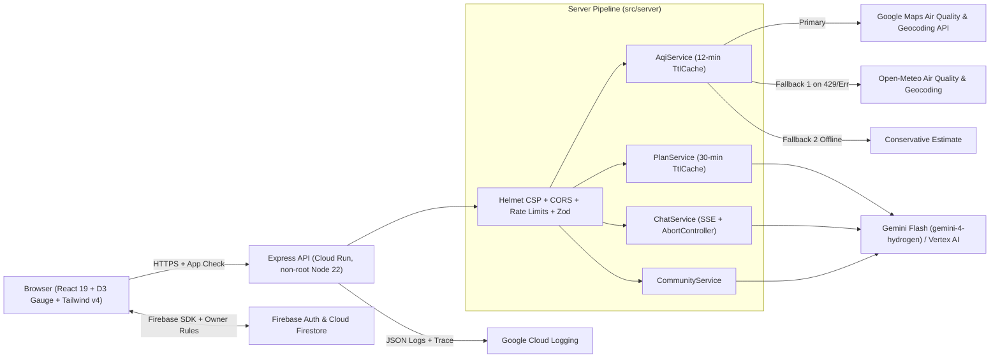

# CleanBreath Architecture

## 1. System Architecture



## 2. Prompt & Data Grounding Flow

```mermaid
sequenceDiagram
  autonumber
  participant Client as Browser
  participant Route as Express Route (/api/plan or /api/chat)
  participant Sanitizer as Zod + Sanitize + Injection Filter
  participant AqiSvc as AqiService (Server-Authoritative)
  participant Gemini as Gemini Flash (gemini-4-hydrogen)

  Client->>Route: POST profile + user messages (client AQI ignored)
  Route->>Sanitizer: Validate Zod schema, drop client "model" turns
  Sanitizer->>Sanitizer: Wrap untrusted fields in XML tags; scan all user turns
  Route->>AqiSvc: Re-fetch live AQI for profile locality/coordinates
  AqiSvc-->>Route: Verified AirQualitySnapshot
  Route->>Gemini: Grounded prompt + responseSchema / abortSignal
  Gemini-->>Route: Structured JSON or token stream
  Route->>Sanitizer: Strip HTML tags, validate schema, stop on req close
  Route-->>Client: JSON response or SSE events (or deterministic fallback)
```

## 3. Security & Trust Boundaries

1. **Server-Only Credentials**: `GEMINI_API_KEY` and `GOOGLE_MAPS_API_KEY` (or Vertex AI Workload Identity via `GOOGLE_GENAI_USE_VERTEXAI=true`) exist strictly on the Node.js server (`src/server/config/env.ts`) and are never bundled into `dist/`.
2. **Server-Authoritative Inputs**: `/api/plan` and `/api/chat` ignore client-submitted `aqi` values and re-fetch AQI server-side. `/api/chat` strips any client-supplied `role: "model"` turns and runs `hasPromptInjectionSignals` across **every** user turn.
3. **Production Transport Hardening**: When `NODE_ENV=production` (`ALLOW_EMBEDDING=false`), `applySecurityMiddleware` enforces `script-src 'self'` (no `'unsafe-inline'`), `frame-ancestors 'self'`, `X-Frame-Options: DENY`, `Cross-Origin-Resource-Policy: same-origin`, strict CORS origin checks (`403`), `64kb` body caps (`413`), generic `90/15m` API limits, `12/15m` strict AI rate limits (`429`), per-IP SSE concurrency limits (`CHAT_MAX_CONCURRENT_PER_IP`), and optional Firebase App Check JWT verification (`src/server/middleware/appCheck.ts`).
4. **Hardened Firestore Rules (`firestore.rules`)**: Default-deny catch-all, path ID regex validation (`^[a-zA-Z0-9_\-]+$`), trusted-user gate (`isTrustedUser()`), strict `hasAll`/`hasOnly` field allow-lists, and `ownerUid == request.auth.uid` checks audited by `@firebase/eslint-plugin-security-rules`.

## 4. Efficiency & Scaling

- **In-Memory `TtlCache` Scope & Scale-Out**: Each Cloud Run container caches AQI lookups for **12 minutes** (`0.01°` rounded coordinates, max 200 keys) and personalized plans for **30 minutes** (max 150 keys) via `TtlCache` (`src/server/utils/cache.ts`). At multi-instance traffic beyond ~100 req/s, the cache interface is designed to swap cleanly to **Cloud Memorystore (Redis)** or a shared **Firestore TTL collection** so warm neighbourhoods share cached responses across revisions.
- **HTTP & Bundle Efficiency**: `GET /api/aqi` emits `Cache-Control: public, max-age=120, stale-while-revalidate=600` + deterministic `ETag` (`304 Not Modified`). Vite splits vendor libraries (`vendor-firebase`, `vendor-d3`, `vendor-motion`) and lazy-loads secondary screens (`OnboardingWizard`, `IndoorHacksPanel`, `ChatAssistant`, `CommunityChecklist`, `RecommendationDetailView`, `SettingsView`).
- **Cloud Run Concurrency & Sizing (`deploy.sh`)**: Configured with `--min-instances 0`, `--max-instances 5`, `--concurrency 40` (appropriate for long-lived SSE chat streams alongside REST lookups), `512Mi` memory, `1 vCPU`, non-root `cleanbreath` user, and `node dist-server/server.js` compiled via esbuild.
